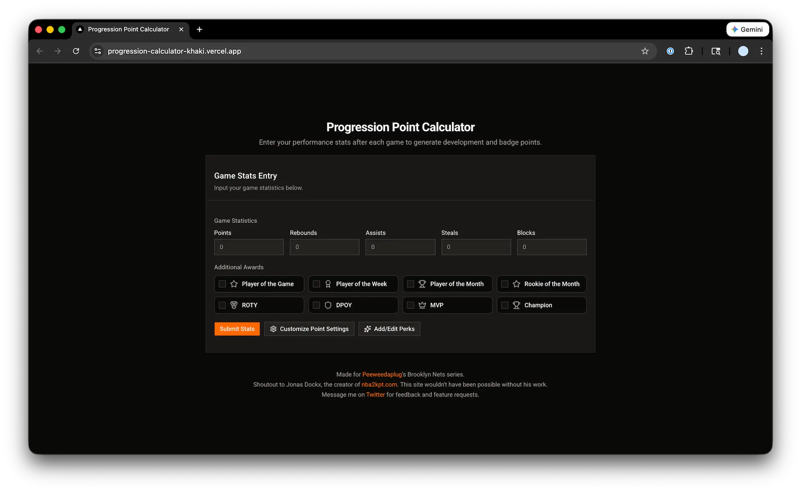
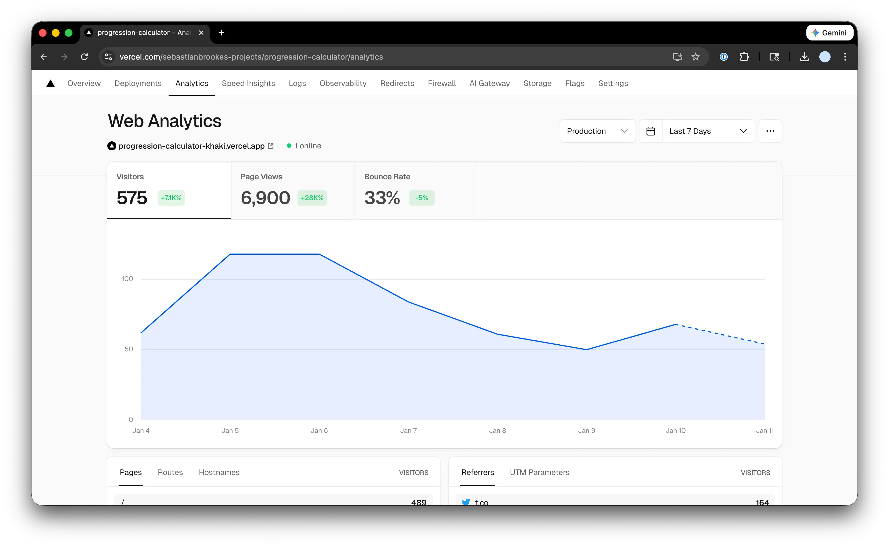

# NBA 2K Progression Calculator

[**🔗 Live Demo**](https://progression-calculator-khaki.vercel.app/)

A modern web app companion for NBA 2K26 MyNBA team rebuild series. Enter your player's game stats and receive calculated development points with randomized perks that add excitement and realism to player progression.



## Features

- **📊 Box score entry** — Points, rebounds, assists, steals, blocks, and awards, with a live point tally as you type
- **🎰 Perk reel** — A slot-style spin for a random buff, nerf, or no effect
- **📈 Points breakdown** — Attribute and badge points, line by line, plus a one-click text summary to copy
- **⚙️ Point rules** — Change what every milestone and award is worth
- **✨ Perk editor** — Edit, add, or remove perks, grouped by type, with the real odds shown
- **💾 Saved on your device** — Point rules autosave; perks save when you press Save. Both live in localStorage
- **📱 Mobile friendly** — Works on a phone next to the TV

## Tech Stack

| Technology | Version | Purpose |
| --- | --- | --- |
| [Next.js](https://nextjs.org/) | 16.4 | React framework |
| [React](https://react.dev/) | 19.3 | UI library |
| [TypeScript](https://www.typescriptlang.org/) | 5.x | Type safety |
| [Tailwind CSS](https://tailwindcss.com/) | 4.x | Styling |
| [Lucide React](https://lucide.dev/) | — | Icons |
| [Vercel](https://vercel.com/) | — | Deployment |

## Getting Started

### Prerequisites

- Node.js 20.9+
- npm or yarn

### Installation

```bash
# Clone the repository
git clone <https://github.com/sebastianbrookes/progression-calculator.git>

# Navigate to project
cd progression-calculator

# Install dependencies
npm install

# Start development server
npm run dev

```

Open [http://localhost:3000](http://localhost:3000/) to view the app.

## Project Structure

```
src/
├── app/                      # Routes. Each page.tsx sets metadata and renders a component.
│   ├── page.tsx              # Log a game
│   ├── spin/                 # Spin for a perk
│   ├── results/              # Game result
│   ├── customize/            # Point rules
│   └── perks/                # Perk editor
├── components/
│   ├── game/                 # Stats form, perk reel, results
│   ├── settings/             # Point rules editor
│   ├── perks/                # Perk editor
│   └── ui/                   # Button, input, confirm dialog
└── lib/
    ├── rules.ts              # Every scoring rule and its default value
    ├── scoring.ts            # scoreGame() and URL encoding of a game
    ├── perks.ts              # Default perks and the draw
    ├── storage.ts            # localStorage-backed stores for React
    └── stores.ts             # Saved rules and perks, incl. migrating old saves
```

To add a scoring rule, add its default to `DEFAULT_SETTINGS` in `rules.ts` and reference it from `STAT_TIERS`, `MULTI_DOUBLES`, or `AWARDS`. The form, the settings page, and the calculator all pick it up from there.

## Scripts

```bash
npm run dev        # Start the dev server
npm test           # Run unit tests (scoring, URL params, saved-data migration)
npm run lint       # ESLint
npm run typecheck  # TypeScript
npm run build      # Production build
```

## How It Works

1. **Log a game** — Enter the box score and any awards (POTG, MVP, etc.)
2. **Spin for a perk** — Or skip it
3. **See the result** — Attribute and badge points with a breakdown, plus the perk you landed

## Deployment

Deployed on [Vercel](https://vercel.com/). Push to `main` for automatic deployment.

```bash
# Build for production
npm run build

# Start production server
npm start

```

## Community Adoption

Real usage data from Vercel Analytics showing community engagement:



## Credits

Inspired by [nba2kpt.com](https://www.nba2kpt.com/) by Jonas Dockx